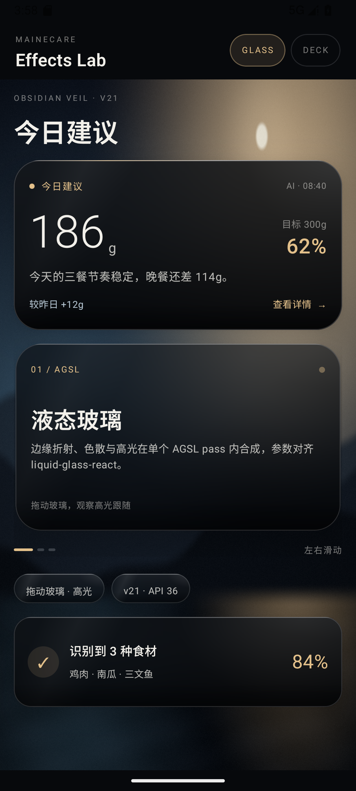

# MaineCare Effects

A reusable Android Compose effects library for MaineCare: liquid glass, card deck, draggable
card stack and coverflow. Phase 1 is a verifiable spike against the MaineCare feeding v21 web
reference; it is **not** wired into the MaineCare app yet.

## Modules

| Module | Contents |
| --- | --- |
| `:motion` | v18/v21 motion tokens, JS-exact semi-implicit spring, geometry helpers, frame telemetry |
| `:glass` | `GlassBackdrop`, `GlassSurface`, AGSL refraction, v21 material presets, displacement maps |
| `:deck` | `CardDeck`, `Coverflow`, `CardStack` |
| `:demo` | two runnable samples plus the fixed 390×844 pixel/motion gate |

`minSdk = 33` (AGSL), `compileSdk = 36`, Compose BOM 2026.03.00, AGP 8.13.0, Kotlin 2.2.21.

## Samples

Glass sample: photo backdrop + advice card + feature deck + controls + insight card.



Deck sample: card deck + draggable/throwable analysis stack + meal coverflow.


## Build and run

```bash
./gradlew :demo:assembleDebug
adb install -r demo/build/outputs/apk/debug/demo-debug.apk
adb shell am start -n com.mainecare.effects.demo.debug/com.mainecare.effects.demo.MainActivity --es screen glass
```

`screen` accepts `glass`, `deck` or `gate`. The gate screen is fixed at 390×844dp and accepts
`displacement=0|1`, `text=0|1`, `shadow=0`, `before=0`, `bg=photo|obsidian`,
`debug=1|2|3|4|6` (constant 0.5 / raw blur / map / graded warp / stage colour) and `trace=0` (disable motion
logs).

## Restoration gate

The gate is defined in [`docs/golden-gate.md`](docs/golden-gate.md) and the measured results
are in [`docs/comparison-report.md`](docs/comparison-report.md). Current status:

- Canonical smooth v21 feeding surface, static: **PASS** (SSIM 0.99536, MAE 0.428,
  99.57% within Δ5; target SSIM ≥0.995, MAE ≤1.0, ≥99% within Δ5).
- Canonical smooth, displacement: **PASS** (SSIM 0.99531, MAE 0.422, 99.65% within Δ5;
  target SSIM ≥0.99, MAE ≤1.5, ≥98% within Δ5).
- Photo stress scene: **FAIL SSIM only** (SSIM 0.9932, MAE 0.796, Δ5 passes); veined
  Obsidian: **FAIL SSIM** (0.9915). The residual is the card shadow on the shared CSS stage
  behind the pill plus the pill’s blurred-alpha composition; see the comparison report.
- Motion: **PASS for the measured coverflow/stack runs** (spring deviation 0.47dp over 25
  frames, exact final state).
- Performance on the shared API36 emulator: **FAIL** (deck 6.23–6.65% janky, P95 32–36ms;
  glass 4.58%, P95 29ms; target 0 janky, P95 ≤17ms). Predates the final material changes;
  V2528A is not connected yet.

No document claims a pass that the numbers do not support.

The App adapter contract is a proposal in
[`docs/app-adapter-contract.md`](docs/app-adapter-contract.md); no dependency or App
integration exists yet.

## Verification harness

- `verification/generate-backdrop.mjs` — deterministic synthetic photo + obsidian PNGs.
- `verification/web-reference/gate.html` — Chromium reference at 390×844, optional
  `?displacement=1`.
- `verification/compare-png.mjs` — MAE/RMSE/PSNR/SSIM/Δ-threshold metrics + diff image.
- `verification/region-metrics.mjs` — per-region metrics for card, pill or named bands.
- `verification/crop-gate.mjs` — locates the fixed frame in a 1080×2400 screenshot.
- `verification/side-by-side.mjs` — builds the evidence side-by-side images.
- `verification/run-gate.sh` — build/install/capture/compare helper (needs an emulator).
- `verification/motion-fit.mjs` — scores a recorded coverflow trace against the JS spring.

## Licensing

Project code is Apache-2.0 (`LICENSE`). Displacement maps and filter math are derived from
liquid-glass-react 1.1.1 (MIT); see [`THIRD_PARTY_NOTICES.md`](THIRD_PARTY_NOTICES.md) and
`third_party/licenses/`. The reviewed Apache-2.0 projects (Haze, Cloudy, AndroidLiquidGlass,
NadeemIqbal/liquid-glass) contributed design review only; no code was copied.

No test accounts, credentials, or personal data are stored in this repository. The demo
backdrops are generated and synthetic.
