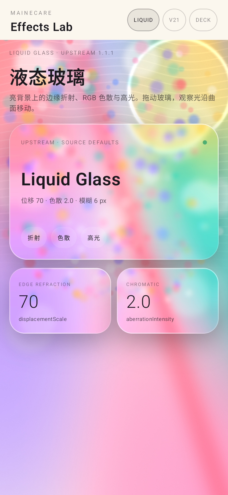
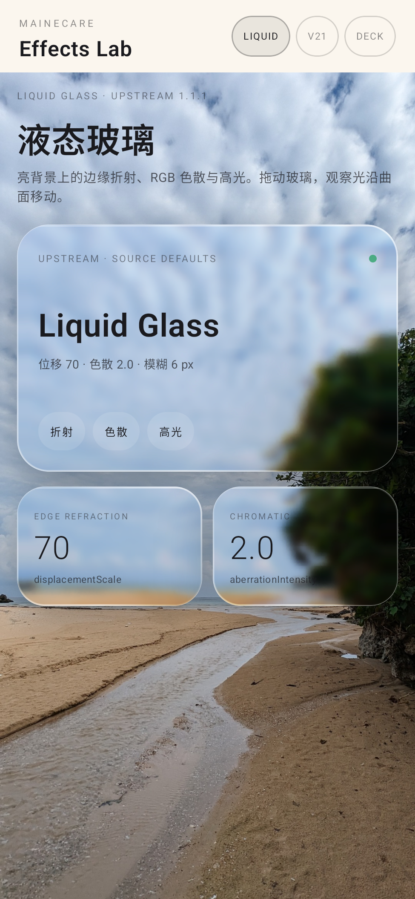
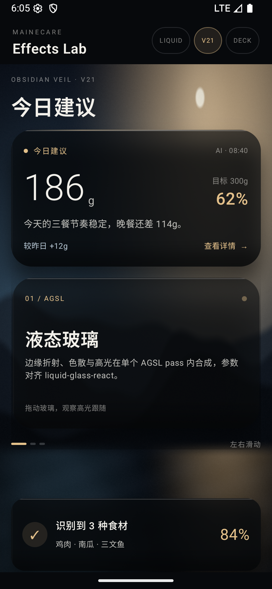
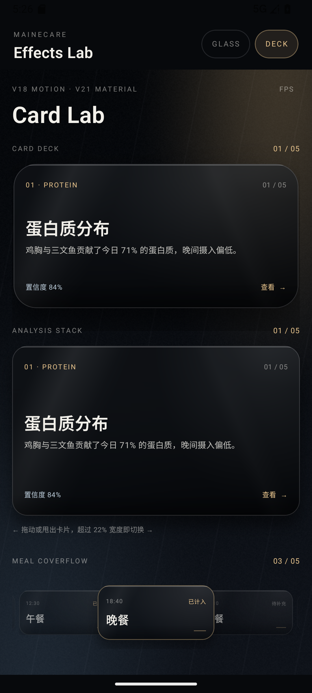

# MaineCare Effects

A reusable Android Compose effects library for MaineCare: liquid glass, card deck, draggable
card stack and coverflow. Version **0.1.4** is published to Maven Local and GitHub Packages;
the MaineCare App is **not** wired to it yet.



The demo opens on this bright liquid-glass page by default: the verified liquid-glass-react
source defaults over a colorful wallpaper, with the v21 Obsidian material moved to the second
tab.

## Modules

| Module | Contents |
| --- | --- |
| `:motion` | v18/v21 motion tokens, JS-exact semi-implicit spring, geometry helpers, frame telemetry |
| `:glass` | `GlassBackdrop`, `GlassSurface`, AGSL refraction, v21 material presets, displacement maps |
| `:deck` | `CardDeck`, `Coverflow`, `CardStack` |
| `:demo` | two runnable samples plus the fixed 390×844 pixel/motion gate |

`minSdk = 33` (AGSL), `compileSdk = 36`, Compose BOM 2026.03.00, AGP 8.13.0, Kotlin 2.2.21.

## Liquid glass

Default demo (`screen=liquid`): bright bokeh wallpaper and the `Upstream` preset with the
source-default `overLight=false` — full 70 displacement, 6px blur, clear glass. The crystal
look comes from AGSL edge refraction, RGB fringing and the specular rim, not from a
transparency overlay. `overLight=true` remains available for the upstream light treatment
(70→35 displacement, 14px blur) but is **not** the default.


Real-photo scene (`screen=liquid-photo`): the same clear glass over a CC0 beach photograph;
the moving highlight and edge distortion are visible over clouds and foliage.



v21 Obsidian is the second tab (`screen=obsidian`), not the default. It keeps the dark tinted
material, gold edge and inner shadow.



Deck sample: card deck + draggable/throwable analysis stack + meal coverflow.



## Build and run

```bash
./gradlew :demo:assembleDebug
adb install -r demo/build/outputs/apk/debug/demo-debug.apk
adb shell am start -n com.mainecare.effects.demo.debug/com.mainecare.effects.demo.MainActivity
```

The default screen is the liquid-glass showcase. `--es screen liquid` opens it with the system
bars hidden; `screen` also accepts `liquid-photo`, `obsidian`, `v21`, `glass`, `deck`, `gate`,
`ab`, `ab-upstream` and `ab-v21`. Add `--es overlight 1` to evaluate the overLight treatment. The gate screen is fixed at 390×844dp and accepts
`displacement=0|1`, `text=0|1`, `shadow=0`, `before=0`, `blur=0`, `bg=photo|obsidian`,
`debug=1|2|3|4|6` (constant 0.5 / raw blur / map / graded warp / stage colour),
`blurMode=cpu` + `blurScale=<factor>` (offscreen box-Gaussian probe) and `trace=0`
(disable motion logs).

## 0.1.4 artifact and adapter

Artifacts (Maven Local, AAR):

```
com.mainecare.effects:motion:0.1.4
com.mainecare.effects:glass:0.1.4
com.mainecare.effects:deck:0.1.4
```

Publish from this checkout:

```bash
./gradlew publishToMavenLocal
```

Consumer settings and dependencies:

```kotlin
dependencyResolutionManagement {
    repositories { mavenLocal(); google(); mavenCentral() }
}
```

```kotlin
dependencies {
    implementation("com.mainecare.effects:glass:0.1.4")
    implementation("com.mainecare.effects:deck:0.1.4")
    implementation(platform("androidx.compose:compose-bom:2026.03.00"))
    implementation("androidx.compose.material3:material3")
}
```

### GitHub Packages (remote)

The same coordinates are published to:

```
https://maven.pkg.github.com/BigStartByXuyb/mainecare-effects
```

Consumer repository:

```kotlin
dependencyResolutionManagement {
    repositories {
        maven {
            url = uri("https://maven.pkg.github.com/BigStartByXuyb/mainecare-effects")
            credentials {
                username = System.getenv("GITHUB_ACTOR") // GitHub username
                password = System.getenv("MAINECARE_EFFECTS_PACKAGES_TOKEN")
            }
        }
        google()
        mavenCentral()
    }
}
```

Authentication for a **private** package:

- Publishing (this repository): GitHub Actions uses the built-in `GITHUB_TOKEN` with
  `permissions: packages: write`; no personal token is stored. The workflow is
  `.github/workflows/publish.yml`.
- Consuming from another repository or locally: create a token with **Packages: Read-only**
  for `BigStartByXuyb/mainecare-effects` (fine-grained token) or a classic token with
  `read:packages`. Store it as the secret `MAINECARE_EFFECTS_PACKAGES_TOKEN` in the consumer
  repository (or export it locally). Do not commit or paste the token.
- In consumer GitHub Actions, the consumer repository's own `GITHUB_TOKEN` normally cannot
  read another private repository's package; use the `MAINECARE_EFFECTS_PACKAGES_TOKEN`
  secret with `permissions: packages: read` on the consuming job.

Maven Local is the local/offline path; GitHub Packages is the cross-machine path.

The only glass seam for the App adapter is `MaineGlassCard`; page code must not construct
`GlassSurface`, shaders or displacement maps:

```kotlin
GlassBackdrop(image = backdropBitmap) {
    MaineGlassCard(
        modifier = Modifier.fillMaxWidth().height(196.dp),
        material = MaineGlassMaterials.Advice,
        interactive = true,
    ) {
        content()
    }
}
```

Presets are `Card`, `Advice`, `MealFront`, `Insight`, `Dock`, `SoftControl`, plus
`Upstream` (liquid-glass-react 1.1.1 source defaults: 70 / .0625 / 140 / 2 / .15 / 999,
clear glass). Its blur follows the source formula: 6px for the dark path and 14px for
`overLight`. `LiquidGlassParams` defaults to those upstream values; the v21 presets keep
their own values. Performance tiers, known ceiling and license carriage are documented in
[`docs/release-0.1.4.md`](docs/release-0.1.4.md). Maven Local was verified
with a separate Android consumer build; GitHub Packages is published by
`.github/workflows/publish.yml`. V2528A install/measure/return steps are in
[`docs/device-acceptance-v2528a.md`](docs/device-acceptance-v2528a.md).

## Restoration gate

The gate is defined in [`docs/golden-gate.md`](docs/golden-gate.md) and the measured results
are in [`docs/comparison-report.md`](docs/comparison-report.md). Current status:

- Canonical smooth v21 feeding surface, static: **PASS** (SSIM 0.99548, MAE 0.421,
  99.59% within Δ5; target SSIM ≥0.995, MAE ≤1.0, ≥99% within Δ5).
- Canonical smooth, displacement: **PASS** (SSIM 0.99542, MAE 0.416, 99.65% within Δ5;
  target SSIM ≥0.99, MAE ≤1.5, ≥98% within Δ5).
- Photo stress scene: **FAIL SSIM only** (SSIM 0.9932, MAE 0.796, Δ5 passes); veined
  Obsidian: **FAIL SSIM** (0.9915). The residual is the card shadow on the shared CSS stage
  behind the pill plus the pill’s blurred-alpha composition; the offscreen CPU
  box-Gaussian attempt reached 0.99324 / 0.99167, confirming the kernel is not the limiter.
  The measured ceiling for the static-backdrop/per-surface-shadow path is **≈0.994**;
  see the comparison report and [`docs/release-0.1.4.md`](docs/release-0.1.4.md).
- Motion: **PASS for the measured coverflow/stack runs** (spring deviation 0.47dp over 25
  frames, exact final state).
- Performance on the shared API36 emulator: **FAIL** (deck 6.23–6.65% janky, P95 32–36ms;
  glass 4.58%, P95 29ms; target 0 janky, P95 ≤17ms). Predates the final material changes;
  V2528A is not connected yet.

No document claims a pass that the numbers do not support.

The App adapter contract is in [`docs/app-adapter-contract.md`](docs/app-adapter-contract.md).
The 0.1.4 artifact exists, but no dependency or App integration exists yet; integration waits
for the merged test package acceptance. The liquid-glass rendering audit is in
[`docs/liquid-glass-0.1.4.md`](docs/liquid-glass-0.1.4.md).

## Upstream A/B

The demo can render the real liquid-glass-react source defaults next to v21:

```bash
adb shell am start -n com.mainecare.effects.demo.debug/com.mainecare.effects.demo.MainActivity \
  --es screen ab --es bg dark
```

`screen=ab` is upstream (left) / v21 (right); `ab-upstream` and `ab-v21` render one full card.
`bg=dark|light|color|flat|line|showcase|photo`, `dispScale` and `blurScale` are diagnostics. The upstream
preset is not a v21 parameter tweak: it uses the verified source defaults and clear rim.
The measured comparison, remaining edge differences, and platform limits are in
[`docs/liquid-glass-0.1.4.md`](docs/liquid-glass-0.1.4.md).

## Verification harness

- `verification/generate-backdrop.mjs` — deterministic synthetic photo + obsidian PNGs.
- `verification/generate-showcase-backdrop.py` — deterministic bright bokeh showcase PNG.
- `verification/web-reference/gate.html` — Chromium reference at 390×844, optional
  `?displacement=1`.
- `verification/compare-png.mjs` — MAE/RMSE/PSNR/SSIM/Δ-threshold metrics + diff image.
- `verification/region-metrics.mjs` — per-region metrics for card, pill or named bands.
- `verification/crop-gate.mjs` — locates the fixed frame in a 1080×2400 screenshot.
- `verification/side-by-side.mjs` — builds the evidence side-by-side images.
- `verification/run-gate.sh` — build/install/capture/compare helper (needs an emulator).
- `verification/motion-fit.mjs` — scores a recorded coverflow trace against the JS spring.

## Licensing

Project code is Apache-2.0 (`LICENSE`). Displacement maps and filter math are derived from
liquid-glass-react 1.1.1 (MIT); see [`THIRD_PARTY_NOTICES.md`](THIRD_PARTY_NOTICES.md) and
`third_party/licenses/`. Every Maven artifact publishes `-license.txt`, `-notice.txt` and
`-third-party-notices.md` classifiers, and the sources jar carries the same files under
`META-INF/`. The reviewed Apache-2.0 projects (Haze, Cloudy, AndroidLiquidGlass,
NadeemIqbal/liquid-glass) contributed design review only; no code was copied.

No test accounts, credentials, or personal data are stored in this repository. The showcase
and landscape backdrops are generated; the beach photo is “Crystal Beach 2” by Syced
(Wikimedia Commons, CC0 1.0), cropped for the portrait demo — see `THIRD_PARTY_NOTICES.md`.
