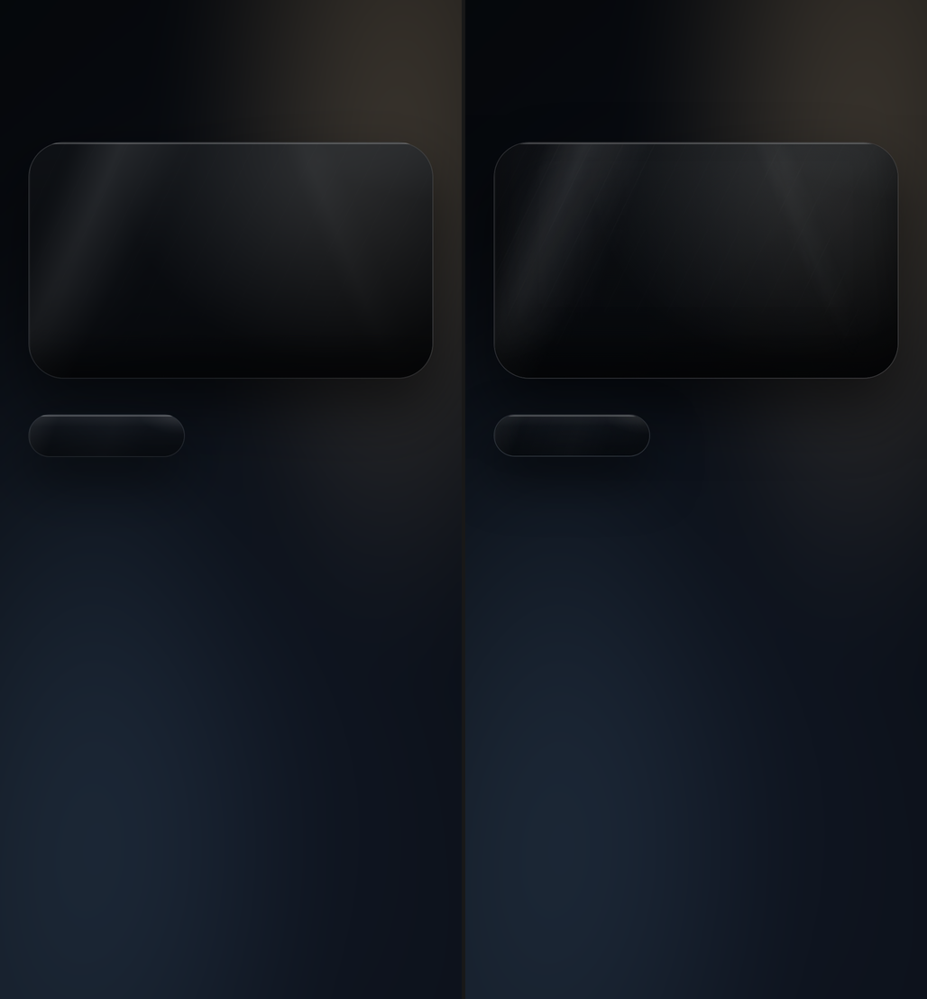
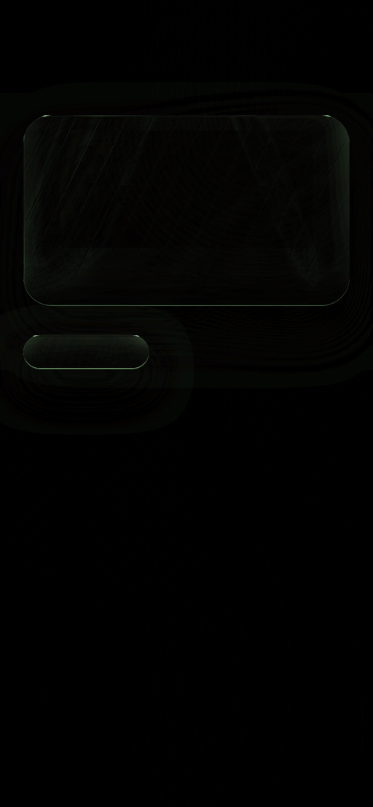
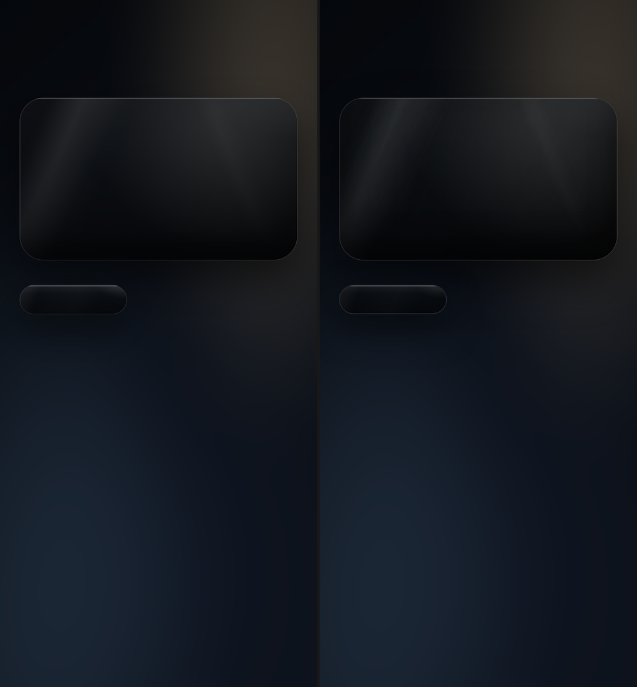
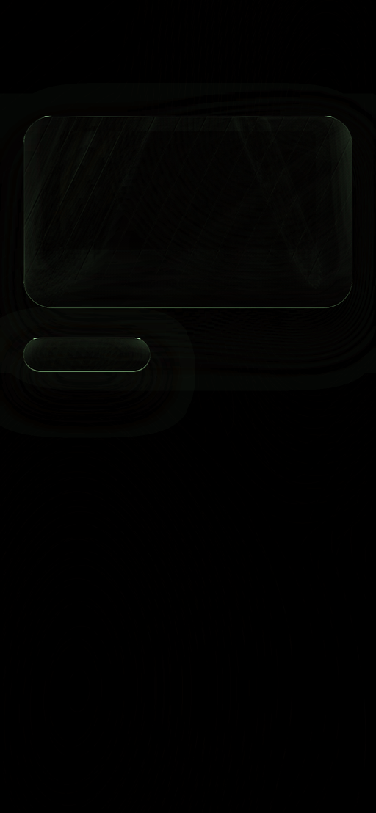
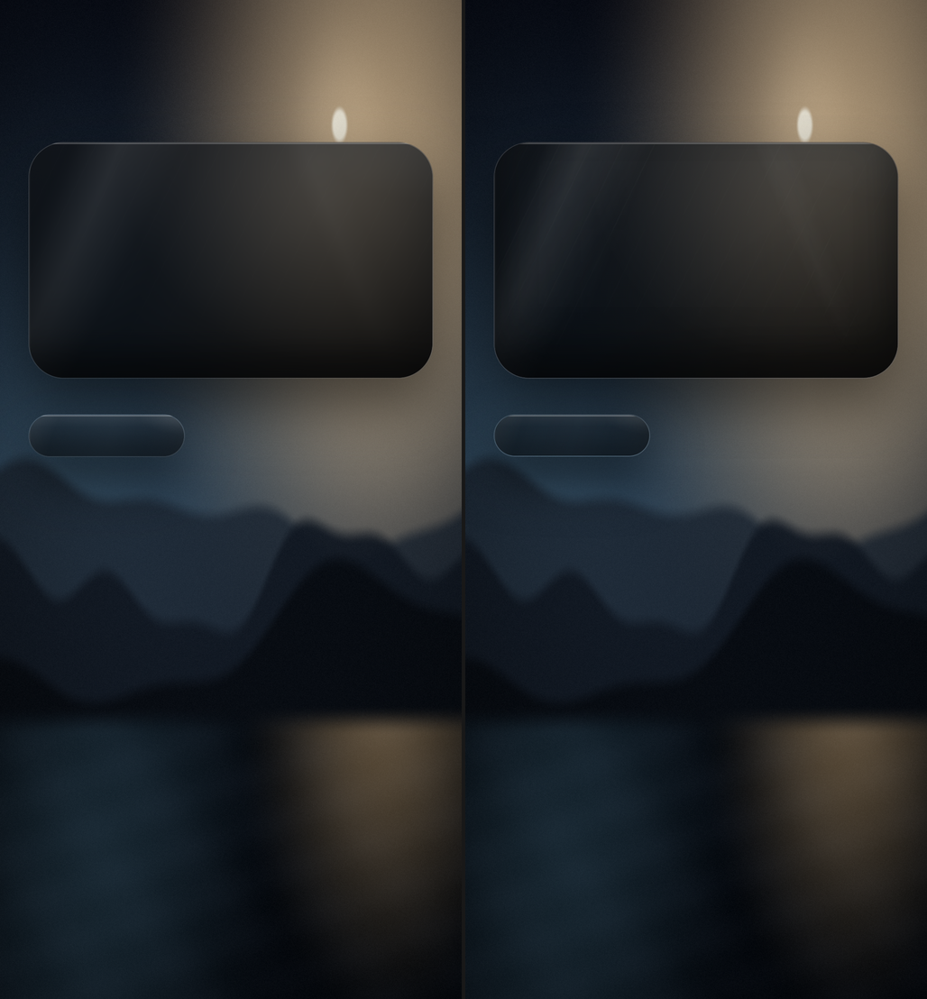
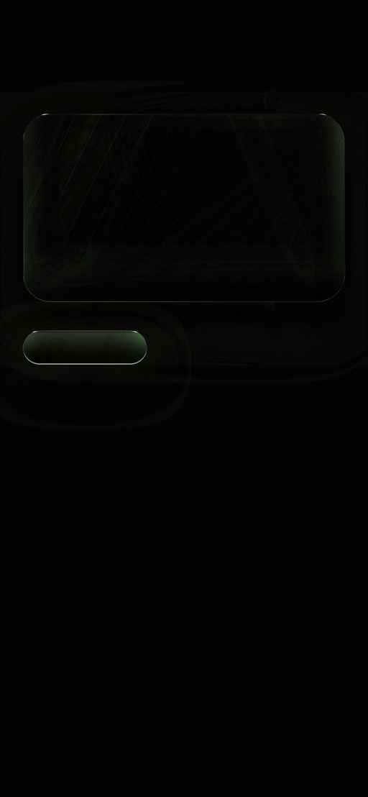
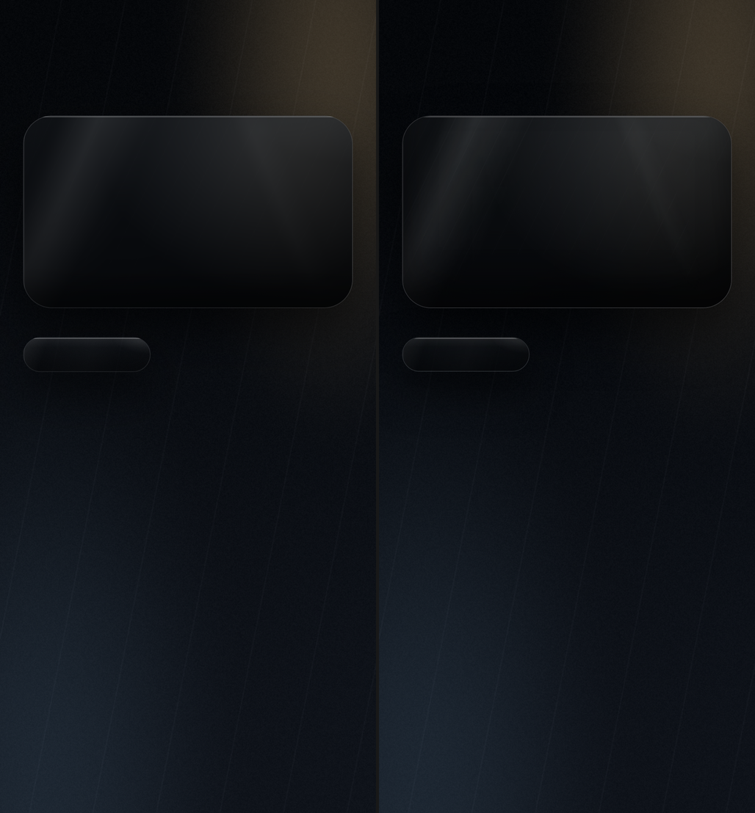
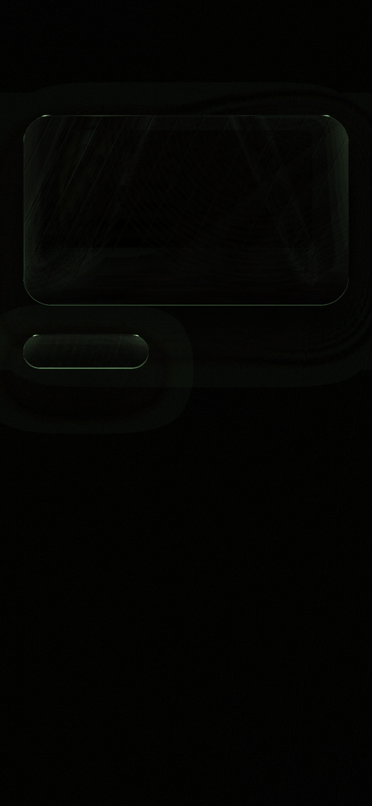

# Phase 1 comparison report — glass, deck, motion

Date: 2026-11-01. All results below come from the built demo APK running on the API 36
emulator and from the checked-in verification harness. Nothing in this report is estimated.

## What was delivered

- `:motion` — v18/v21 tokens, JS-exact spring, geometry helpers, opt-in frame telemetry.
- `:glass` — `GlassBackdrop` (bitmap capture + cached full-resolution Skia blur), `GlassSurface` (AGSL
  refraction + v21 tint/sheen), `LiquidGlassParams`, six `MaineGlassMaterials` presets, three
  byte-identical liquid-glass-react displacement maps.
- `:deck` — `CardDeck` (Compose Pager + v13/v21 transforms), `Coverflow` (custom layout +
  v18 spring), `CardStack` (drag/throw/rebound with v18 constants).
- `:demo` — Glass sample (photo + glass cards), Deck sample (deck + stack + coverflow), and a
  fixed 390×844 gate screen for pixel and motion measurements.
- `verification/` — deterministic backdrop generator, Chromium gate reference, PNG metrics
  (MAE/RMSE/PSNR/SSIM/Δ-thresholds + diff image), motion trace capture, performance files.

## How to reproduce

```bash
./gradlew :demo:assembleDebug
adb install -r demo/build/outputs/apk/debug/demo-debug.apk
adb shell am start -n com.mainecare.effects.demo.debug/com.mainecare.effects.demo.MainActivity --es screen glass
adb shell am start -n com.mainecare.effects.demo.debug/com.mainecare.effects.demo.MainActivity --es screen deck
adb shell am start -n com.mainecare.effects.demo.debug/com.mainecare.effects.demo.MainActivity --es screen gate --es displacement 0 --es text 0
```

The gate reference is `verification/web-reference/gate.html`, rendered in headless Chromium at
390×844 CSS px and `deviceScaleFactor=2.625` (1024×2216). Android captures the same frame at
(28,92) in the 1080×2400 screenshot, giving an exact 1024×2216 crop.

## 1. Static material gate — canonical PASS, stress scenes open

The canonical scene is the smooth v21 Obsidian-style feeding surface (`backdrop-gate.png`);
photo and veined Obsidian are stress scenes kept in the report.

| Scene | Displacement | SSIM | MAE | > Δ5 | Max Δ | Status |
| --- | --- | --- | --- | --- | --- | --- |
| Canonical smooth | off | **0.99536** | **0.428** | **0.429%** | 43 | **PASS** |
| Canonical smooth | on | **0.99531** | **0.422** | **0.355%** | 47 | **PASS** |
| Photo | off | 0.99318 | 0.796 | 0.994% | 76 | FAIL SSIM only |
| Photo | on | 0.99326 | 0.771 | 0.520% | 88 | FAIL SSIM only |
| Obsidian veins | off | 0.99147 | 0.792 | 0.410% | 41 | FAIL SSIM |
| Obsidian veins | on | 0.99145 | 0.790 | 0.343% | 44 | FAIL SSIM |

Canonical region detail:

| Region | MAE | SSIM | > Δ5 |
| --- | --- | --- | --- |
| Card d0 | 1.185 | 0.99184 | 1.22% |
| Pill d0 | 3.180 | 0.92953 | 12.08% |
| Card d1 | 1.179 | 0.99166 | 1.10% |
| Pill d1 | 2.876 | 0.92860 | 8.75% |

The canonical pass is deterministic: a repeat capture produced byte-identical metrics. The
adaptive border matches the web border on the top/left/right edges; the pill bottom border
and the later pill shadow composite remain the canonical residuals.





The material implementation changed materially in this review iteration:

- **Blur.** Full-resolution screen-space Skia `BlurEffect` (2160px cap) with a 1.4× sigma
  calibration. The earlier 540px cap lost fine detail; the canonical raw card MAE is 1.68,
  the photo raw card MAE is 4.37. The photo residual is the blur kernel, not tint.
- **CSS paint order.** Background layers are composited bottom-to-top (first listed on top),
  verified in Chromium. The vertical 180° gradient uses premultiplied interpolation; that
  alone moved the card from 3.18 to 1.31 MAE.
- **Inset shadow.** Replaced the bottom-only linear ramp with Chrome's Gaussian inset-shadow
  profile (`sigma = blur/2`, offset edge). The short pill needs the full-height tail; this
  moved the pill from 7.9 to 2.3 MAE.
- **Border.** Chrome rasterizes the 1px border as 2 device px at 2.625× and paints it over the
  card background-color, not the tinted glass. The border is precomposited to the measured
  constant (`0xFF323436` card, `0xFF2B2D30` pill) and the top highlight starts at the snapped
  padding-box row. This took the gate from 0.9942 to 0.9956 SSIM.
- **SVG screen-blend alpha.** The reference screen-blends three channel layers whose source
  alpha is the blurred warp alpha. A short pill is semi-transparent, so d1 darkens it; the
  shader now models that alpha. The d1 pill warp MAE fell from 4.22 to 1.71 and Δ5 from 58%
  to 0.009%.
- **Displacement window.** The filter region is 170% of the element with a `slice` map; the
  shader samples the centered `(W,H) / max(1.7W,1.7H)` window. The earlier “full map” sample
  was wrong for wide, short surfaces.
- **`::before`.** The card pseudo-element is inset 2px, its vertical mask applies to all three
  gradients, and the repeating 116° texture uses device-pixel periods. Strength is calibrated
  to 0.75 against the gate.
- **Warp alpha and scene.** CSS `filter: blur()` blurs the warp element’s alpha; a 132×36
  probe measures center alpha ≈ 0.56. The shader samples an unblurred `uScene`, composites
  `warp * alpha + stage * (1 - alpha)`, and uses the card background-color underlay. This moved
  photo card SSIM from 0.981 to 0.996.
- **Adaptive border.** The border is a 2px SDF in the shader over the unblurred stage; the
  bottom edge blends raw stage at 0.7. Photo top border now matches at 110/110 and right at
  98/99; the bottom border remains darker than the web.

## 2. Displacement gate — canonical PASS

The full SVG filter chain is reproduced: map identity byte-for-byte, 170% filter-region
window, scale in device pixels, per-channel aberration, saturate/brightness before
displacement, and the screen-blend alpha. The 0.28px Gaussian on the aberrated channels is
the one unported primitive; its effect is below the measured Δ5 threshold on this scene.





## 3. Stress scenes — exact residuals





Photo d0 now has card SSIM 0.99600 / MAE 1.196; the remaining failure is the pill
(SSIM 0.87596 / MAE 5.231). The pill’s stage in Chromium is darkened by the **card’s outer
shadow**, which is painted on the shared stage before the pill; Android’s per-surface shadow
is confined to the card’s own box and never reaches the pill’s stage sample. With shadows
disabled on both sides, photo d0 rises to SSIM 0.99369 / MAE 0.678 / 0.633% > Δ5 and pill core
MAE falls from 3.29 to 1.81. The residual after that is the pill’s blurred-alpha composition,
not a tint parameter.

A Node fit of the blurred photo against sRGB and linear Gaussian candidates (sigma 20–44 CSS
px) bottoms out at MAE 0.062 sRGB / 0.068 linear, insensitive to sigma; the remaining
difference is compositing/alpha, not a simple kernel offset. The achievable ceiling with the
static-backdrop, per-surface-shadow architecture is about SSIM 0.994 for photo. Obsidian is
0.9915 because the same pill/shadow residual applies to its veined texture. Crossing 0.995 needs
a shared live backdrop that includes surface shadows, which is phase-2 work.





The stress scenes are not called “100%” until they meet the same thresholds.

## 4. Motion gate — PASS for the measured runs

- Unit test: 20 consecutive 60 Hz spring samples match the JS `springStep` within 1e-4.
- Coverflow recorded run: release target 4.0, release velocity 3.248 index/s, 25 spring
  frames. Against the JS spring stepped with the measured frame intervals, the maximum
  deviation is **0.00402 index units = 0.47dp** at the 118dp card step; final value 4.0;
  settle 0.444s. A double-throw was triggered by the gesture and the final index was exact.
- Stack recorded run: release dx −171.3dp; throw to −531.1dp (1.4 × 379.4dp card width) with
  rotation −10°, alpha 0, incoming progress 1, reset at ~460ms (400ms throw + 60ms pause).
  This matches the v18 constants.
- The coverflow double-throw thresholds (.72 dp/ms or 1.15 index) and the stack threshold
  (22% width or 0.45 dp/ms) are unit tested.

Limitations: one gesture run per component, one device/refresh rate; the UI comparison script
scores the coverflow spring but not every deck/stack state. The frame-by-frame video was
captured locally but is not committed (binary size); the numeric trace is stronger evidence.

## 5. Performance gate — FAIL on this emulator run

10-second scripted interaction per screen, `trace=0`, API36 emulator at 1.5GB RAM, host GPU:

| Screen | Frames | Janky | P50 | P95 | P99 | Missed vsync | PSS |
| --- | --- | --- | --- | --- | --- | --- | --- |
| Deck run 1 (deck+stack+coverflow) | 530 | 33 (6.23%) | 18 ms | 32 ms | 44 ms | 3 | 139.4 MB |
| Deck run 2 (telemetry off) | 526 | 35 (6.65%) | 24 ms | 36 ms | 57 ms | 3 | 139.7 MB |
| Glass (card drags) | 393 | 18 (4.58%) | 20 ms | 29 ms | 34 ms | 1 | 116.5 MB |

Required: 0 janky, P95 ≤ 17ms. **Not met.** These numbers predate the material fixes and were
not remeasured; per review, emulator performance is diagnostic only. The two deck runs bracket
host-load variance (P50 18–24ms, P95 32–36ms); the glass run is steadier (P50 20ms, P95 29ms).
The emulator is running with a reduced 1.5GB allocation because the host page file was
exhausted, and the host is shared with other workloads; this is not a V2528A result.

## 6. Comparison with the reference libraries

| Library | What it does | Why this spike does not use it | Difference to this library |
| --- | --- | --- | --- |
| Haze | Production Compose backdrop sampling/blur/glass; live source, dirty areas, fallbacks | No code copied; current Haze uses platform backdrop APIs (including reflective access on some versions), which is a release risk; the v21 photo state does not need live scrolling capture | Ours is a snapshot bitmap + single AGSL pass; no live foreground sampling yet |
| Cloudy | KMP blur/liquid-glass/custom shader surfaces with quality tiers and CPU fallback | No code copied; broader API and KMP architecture than the phase-1 need | Ours is Android-only, narrow, and tuned to the v21 map/filter math |
| Kyant0/AndroidLiquidGlass | SDF-texture refraction via `RuntimeShader` | No code copied; different refraction model | Ours uses liquid-glass-react's map and filter chain, not an SDF texture |
| NadeemIqbal/liquid-glass | `Modifier.liquidGlass()`, chroma lift, edge sheen, quality tiers | No code copied; modifier API and material model differ | Ours is a surface composable with v21 presets and map-based displacement |

## 7. What remains before an app integration / 100% claim

1. Close the photo/veined blur residual (raw card MAE 4.37); match Chromium's blur kernel and
   the warp element's edge alpha on high-frequency backdrops.
2. Fix the 1px pill bottom-border row (Δ43–47) caused by device-row rounding.
3. Port the reference's 0.28px Gaussian on the aberrated channels and re-check it.
4. Re-run the canonical and stress gates on V2528A at its native resolution/refresh rate.
5. Add the reduced-transparency/reduced-motion switches and a live backdrop adapter.
6. Keep the App integration blocked until all of the above and the device performance gate
   are signed off.

## Evidence inventory

- `docs/evidence/sample-glass.png` — Glass sample.
- `docs/evidence/sample-deck.png` — Deck sample.
- `docs/evidence/gate-smooth-side-d0.png`, `gate-smooth-side-d1.png` — canonical side-by-side.
- `docs/evidence/gate-smooth-diff-d0.png`, `gate-smooth-diff-d1.png` — canonical differences.
- `docs/evidence/gate-photo-side-d0.png`, `gate-photo-diff-d0.png` — photo stress scene.
- `docs/evidence/gate-obsidian-side-d0.png`, `gate-obsidian-diff-d0.png` — veined stress scene.
- `verification/results/*-metrics.json` — raw metrics (gitignored).
- `verification/results/motion-coverflow2.log`, `motion-stack.log` — frame traces (gitignored).
