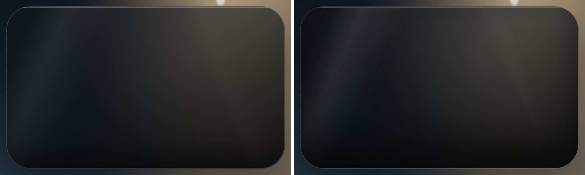
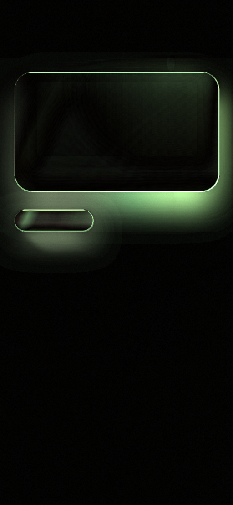
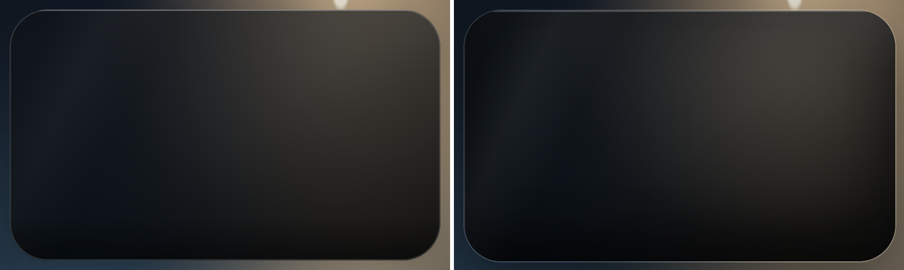
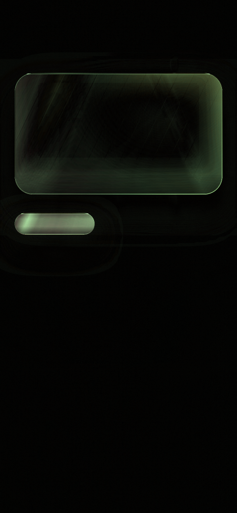

# Phase 1 comparison report — glass, deck, motion

Date: 2026-11-01. All results below come from the built demo APK running on the API 36
emulator and from the checked-in verification harness. Nothing in this report is estimated.

## What was delivered

- `:motion` — v18/v21 tokens, JS-exact spring, geometry helpers, opt-in frame telemetry.
- `:glass` — `GlassBackdrop` (bitmap capture + cached box blur), `GlassSurface` (AGSL
  refraction + v21 tint/sheen), `LiquidGlassParams`, six `MaineGlassMaterials` presets, three
  byte-identical liquid-glass-react displacement maps.
- `:deck` — `CardDeck` (Compose Pager + v13/v21 transforms), `Coverflow` (custom layout +
  v18 spring), `CardStack` (drag/throw/rebound with v18 constants).
- `:demo` — Glass sample (photo + glass cards), Deck sample (deck + stack + coverflow), and a
  fixed 390×844 gate screen for pixel and motion measurements.
- `verification/` — deterministic backdrop generator, Chromium gate reference, PNG metrics
  (MAE/RMSE/PSNR/SSIM/Δ-thresholds + diff image), motion trace capture, performance files.

## How to reproduce

```bash
./gradlew :demo:assembleDebug
adb install -r demo/build/outputs/apk/debug/demo-debug.apk
adb shell am start -n com.mainecare.effects.demo.debug/com.mainecare.effects.demo.MainActivity --es screen glass
adb shell am start -n com.mainecare.effects.demo.debug/com.mainecare.effects.demo.MainActivity --es screen deck
adb shell am start -n com.mainecare.effects.demo.debug/com.mainecare.effects.demo.MainActivity --es screen gate --es displacement 0 --es text 0
```

The gate reference is `verification/web-reference/gate.html`, rendered in headless Chromium at
390×844 CSS px and `deviceScaleFactor=2.625` (1024×2216). Android captures the same frame at
(28,92) in the 1080×2400 screenshot, giving an exact 1024×2216 crop.

## 1. Static material gate — FAIL

Android (left) vs Chromium reference (right), card plus surrounding backdrop:



Difference image (bright = larger Δ; full frame):



| Region | MAE | RMSE | Max Δ | > Δ5 | > Δ10 |
| --- | --- | --- | --- | --- | --- |
| Whole 1024×2216 frame | 2.775 | 6.884 | 110 | 13.49% | 7.95% |
| Card (898×525) | 3.59 | 6.68 | 105 | 12.7% | 2.8% |
| Pill (347×95) | 12.16 | 15.35 | 60 | 81.3% | 49.2% |
| Background top | 1.04 | 1.46 | 9 | 0.7% | 0% |
| Background bottom | 1.26 | 3.15 | 41 | 3.6% | 2.1% |

Whole-frame SSIM 0.97836, PSNR 31.37 dB. Required: SSIM ≥ 0.995, MAE ≤ 1.0, ≥99% within Δ5.
**Not met.**

The background alignment is good (MAE ~1, no structural error), which isolates the mismatch to
the material: CSS `backdrop-filter` plus five background-image layers is reproduced by a single
AGSL pass with a pre-blurred bitmap, and the remaining differences are exactly the parts where
those models differ:

- **Blur model.** The bitmap is downscaled to 360px and blurred with three box passes. CSS
  `blur(34px)` is a Gaussian in the element's own compositing pass. Bright, high-contrast areas
  near the card's top-right are ~7/255 darker on Android.
- **Layer model.** The v21 `feature-card::before` diagonal/repeating texture is not ported.
  The advice `::after` bottom glow and the modal/toast variants are also not ported.
- **Edge model.** Compose strokes/`Modifier.shadow` are not CSS `box-shadow` (spread, blur and
  inset shadow profiles differ). The border/highlight accounts for the max-Δ outliers at the
  card outline.
- **Pill.** Its 36dp height makes the inset shadow and the 1px border a much larger fraction of
  the surface; the pill is the worst region and is reported separately rather than averaged
  away.

A debug shader output of constant 0.5 renders as 127, so the shader writes sRGB rather than
linear; the difference is not a gamma mismatch.

## 2. Displacement gate — FAIL





| Region | MAE | RMSE | Max Δ | > Δ5 | > Δ10 |
| --- | --- | --- | --- | --- | --- |
| Whole frame | 3.053 | 7.327 | 116 | 15.65% | 9.07% |
| Card | 4.51 | 7.5 | 110 | 21.9% | 5.0% |
| Pill | 23.83 | 25.28 | 60 | 99.7% | 95.4% |

Whole-frame SSIM 0.97540, PSNR 30.83 dB. Enabling displacement changes 420,403 pixels with a
maximum channel Δ of 55, so refraction is active; the gate fails because the material baseline
already fails and the pill exposes the map-window difference:

- liquid-glass-react puts the displacement map in a 170% filter region with
  `preserveAspectRatio="xMidYMid slice"`. The shader currently samples the map over the card
  directly (the attempted 170%-window port made the pill worse and was reverted). The card is
  close because its aspect ratio is near the map's; the 132×36 pill is not.
- The aberration scales are ported with the correct sign (`S`, `S−a*.05`, `S−a*.1` for
  R/G/B) and the discrete edge mask is ported. The reference's 0.28px Gaussian on the
  aberrated channels is not.

## 3. Parameter gate — mostly exact, not complete

The values in `docs/golden-gate.md` are checked line by line. Highlights:

- Card tint `rgba(10,12,15,.56)`, blur 34, saturate 132%, brightness .82: exact values.
- Advice tint `.66`, blur 32, saturate 134%, brightness .80, gold top edge: exact values;
  bottom `::after` glow missing.
- Meal front `.52` / 22 / 132% / .84, radius 16: exact values; selected gold border partial.
- Insight `.76` / 26 / 132% / .84, radius 20: exact values.
- Dock `.40` / 24 / 138% / .88 plus glass-sheen: exact values; pill inset-shadow profile
  differs.
- Displacement maps: byte-identical to liquid-glass-react 1.1.1.

The gate is **FAIL** because “100%” includes the missing `::before`/`::after` layers and the
shadow model, not just the numeric CSS values.

## 4. Motion gate — PASS for the measured runs

- Unit test: 20 consecutive 60 Hz spring samples match the JS `springStep` within 1e-4.
- Coverflow recorded run: release target 4.0, release velocity 3.248 index/s, 25 spring
  frames. Against the JS spring stepped with the measured frame intervals, the maximum
  deviation is **0.00402 index units = 0.47dp** at the 118dp card step; final value 4.0;
  settle 0.444s. A double-throw was triggered by the gesture and the final index was exact.
- Stack recorded run: release dx −171.3dp; throw to −531.1dp (1.4 × 379.4dp card width) with
  rotation −10°, alpha 0, incoming progress 1, reset at ~460ms (400ms throw + 60ms pause).
  This matches the v18 constants.
- The coverflow double-throw thresholds (.72 dp/ms or 1.15 index) and the stack threshold
  (22% width or 0.45 dp/ms) are unit tested.

Limitations: one gesture run per component, one device/refresh rate; the UI comparison script
scores the coverflow spring but not every deck/stack state. The frame-by-frame video was
captured locally but is not committed (binary size); the numeric trace is stronger evidence.

## 5. Performance gate — FAIL on this emulator run

10-second scripted interaction per screen, `trace=0`, API36 emulator at 1.5GB RAM, host GPU:

| Screen | Frames | Janky | P50 | P95 | P99 | Missed vsync | PSS |
| --- | --- | --- | --- | --- | --- | --- | --- |
| Deck run 1 (deck+stack+coverflow) | 530 | 33 (6.23%) | 18 ms | 32 ms | 44 ms | 3 | 139.4 MB |
| Deck run 2 (telemetry off) | 526 | 35 (6.65%) | 24 ms | 36 ms | 57 ms | 3 | 139.7 MB |
| Glass (card drags) | 393 | 18 (4.58%) | 20 ms | 29 ms | 34 ms | 1 | 116.5 MB |

Required: 0 janky, P95 ≤ 17ms. **Not met.** The two deck runs bracket host-load variance
(P50 18–24ms, P95 32–36ms); the glass run is steadier (P50 20ms, P95 29ms). The emulator is
running with a reduced 1.5GB allocation because the host page file was exhausted, and the host
is shared with other workloads; this is not a V2528A result. Removing per-frame `CardDeck`
recomposition helped one run but did not reach the threshold.

## 6. Comparison with the reference libraries

| Library | What it does | Why this spike does not use it | Difference to this library |
| --- | --- | --- | --- |
| Haze | Production Compose backdrop sampling/blur/glass; live source, dirty areas, fallbacks | No code copied; current Haze uses platform backdrop APIs (including reflective access on some versions), which is a release risk; the v21 photo state does not need live scrolling capture | Ours is a snapshot bitmap + single AGSL pass; no live foreground sampling yet |
| Cloudy | KMP blur/liquid-glass/custom shader surfaces with quality tiers and CPU fallback | No code copied; broader API and KMP architecture than the phase-1 need | Ours is Android-only, narrow, and tuned to the v21 map/filter math |
| Kyant0/AndroidLiquidGlass | SDF-texture refraction via `RuntimeShader` | No code copied; different refraction model | Ours uses liquid-glass-react's map and filter chain, not an SDF texture |
| NadeemIqbal/liquid-glass | `Modifier.liquidGlass()`, chroma lift, edge sheen, quality tiers | No code copied; modifier API and material model differ | Ours is a surface composable with v21 presets and map-based displacement |

## 7. What is required before an app integration / 100% claim

1. Replace the box-blur approximation with a reference-matching Gaussian (or calibrate the
   box passes against the gate until the card MAE is below threshold).
2. Port `feature-card::before`, `advice::after`, and the remaining per-layer textures, or
   explicitly descope them with the user.
3. Replace `Modifier.shadow` with a CSS-profile shadow (RenderEffect or a blurred shape) and
   tune the inset shadow for small surfaces (pill).
4. Implement the 170% filter-region + `slice` map window exactly, especially for the pill.
5. Re-run the gate on V2528A at its native resolution/refresh rate; the emulator numbers are
   pre-acceptance only.
6. Add the reduced-transparency/reduced-motion switches and a live backdrop adapter before
   the App consumes the library.

## Evidence inventory

- `docs/evidence/sample-glass.png` — Glass sample.
- `docs/evidence/sample-deck.png` — Deck sample.
- `docs/evidence/gate-card-side-d0.png`, `gate-card-side-d1.png` — card side-by-side.
- `docs/evidence/gate-pill-side-d0.png`, `gate-pill-side-d1.png` — pill side-by-side.
- `docs/evidence/gate-diff-d0.png`, `gate-diff-d1.png` — full-frame difference images.
- `docs/evidence/gate-d0-metrics.json`, `gate-d1-metrics.json` — raw metric JSON.
- `verification/results/gfxinfo-*.txt`, `meminfo-*.txt` — raw device output (gitignored).
- `verification/results/motion-coverflow2.log`, `motion-stack.log` — frame traces.
