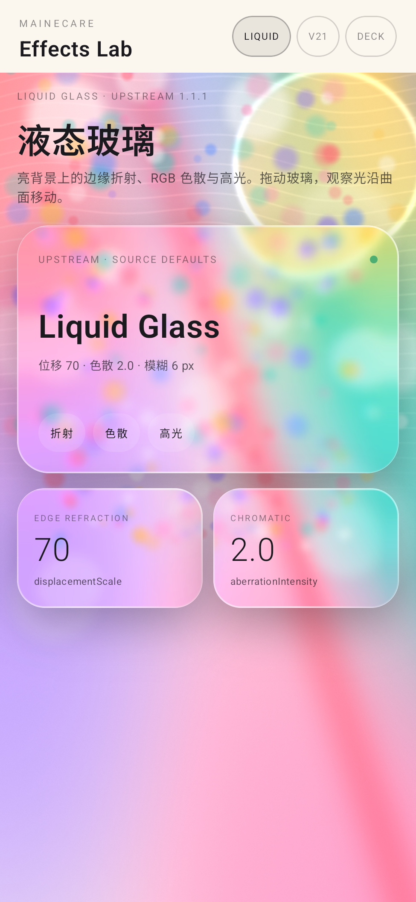
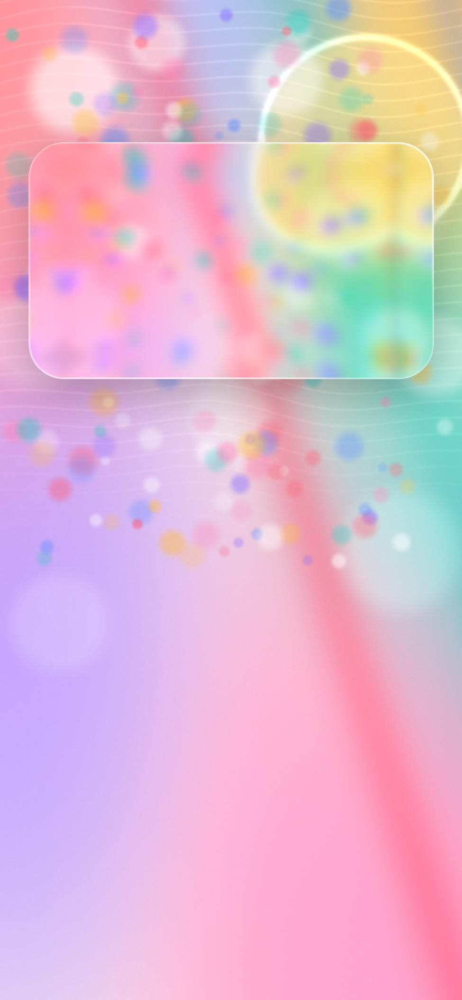
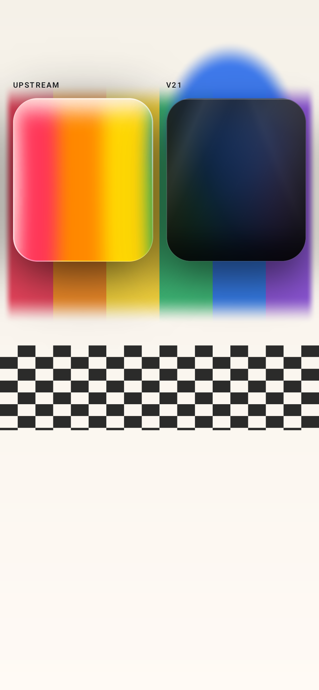
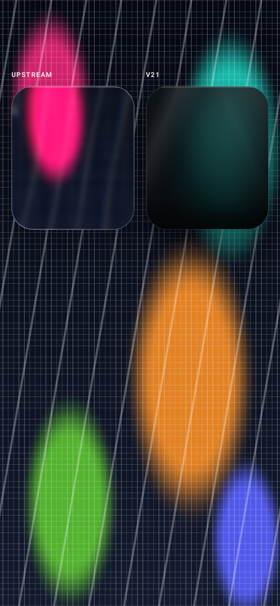

> Superseded by 0.1.4. 0.1.3 used `overLight=true` on the bright showcase, which halved
> displacement (70→35) and raised blur (6→14px), producing the milky look. 0.1.4 uses the
> source-default `overLight=false`; see `docs/liquid-glass-0.1.4.md`.

# Liquid glass audit — 0.1.3

Date: 2026-11-06. Branch: `release-0.1.3`.

This release answers the public-repository feedback that the effects demo looked like “all
black cards” and did not show the liquid-glass feel of `liquid-glass-react`.

## What changed

1. **The demo now opens on a liquid-glass showcase.** `LiquidShowcaseScreen` is the default
   tab (`screen=liquid` also hides the system bars for a clean capture). It uses a bright,
   generated bokeh wallpaper and the `Upstream` preset with `overLight=true`. The v21 Obsidian
   gallery moved to the second tab (`V21`, `screen=obsidian`); it is no longer the first
   screen.
2. **README first image** is the showcase capture, not the dark v21 sample.
3. **Upstream overLight blur corrected.** liquid-glass-react 1.1.1 computes the backdrop blur
   as `(overLight ? 12 : 4) + blurAmount * 32` px. With the source default `blurAmount=.0625`
   that is **14 px** for `overLight` and **6 px** for the dark path. 0.1.1 always used the
   material's 6 px, so the bright/overLight card was under-blurred relative to upstream. The
   shader/backdrop now derives the effective radius from `LiquidGlassParams.liquidBlurRadiusDp`
   for `GlassEdgeStyle.Upstream`; v21 presets keep their explicit radius.
4. **A/B harness supports `--es bg showcase`**, so the real React component and the Android
   card can be compared over the same bright wallpaper.

No upstream parameter was changed to make a screenshot look better. `displacementScale=70`,
`aberrationIntensity=2`, `blurAmount=.0625`, `saturation=140`, `elasticity=.15` and
`cornerRadius=999` remain the source defaults; the showcase only overrides corner radius to
30dp for card geometry and sets `overLight=true` for the bright background.

## Refraction is present on the device

A line probe (`screen=ab-upstream --es bg line`) was captured with displacement on and off.
The on/off card difference is MAE **18.35** (SSIM 0.337); the top/bottom edge bands differ by
MAE **30.6 / 31.2**, the right edge by **22.5**, the left edge by **8.3**. The on capture shows
bent lines and red/blue fringing at the card edge; the off capture shows straight neutral
lines.

- `evidence/liquid-refraction-line-on.png`
- `evidence/liquid-refraction-line-off.png`
- `evidence/liquid-refraction-line-on-off.png` (left: on, right: off)
- `evidence/liquid-refraction-line-regions.json`

The white specular rim is visible in `evidence/liquid-showcase-390.png`. The edge highlight
uses liquid-glass-react's 1.5 px screen/overlay gradient plus the 0.5 px white inset stroke.

## A/B against the real upstream component

The reference is React 19 + installed `liquid-glass-react@1.1.1` rendered in Chromium at
device scale 2.5; the Android side is the shipped demo at 400 dpi. Card geometry is 342×200
at (24,120), radius 30dp, same background.

| Comparison | Card MAE | Card SSIM | Inner MAE | Inner SSIM |
| --- | --- | --- | --- | --- |
| Showcase bright wallpaper, 390 | **3.51** | **0.951** | **3.24** | **0.953** |
| 390 dark | 16.52 | 0.852 | 14.35 | 0.884 |
| 390 light | 7.60 | 0.932 | 6.14 | 0.957 |
| 430 dark | 11.63 | 0.957 | 10.64 | 0.964 |
| 430 light | 6.64 | 0.962 | 5.40 | 0.977 |

The bright showcase is the closest match: the overLight blur fix lowered card MAE from 6.84
to 3.51 and raised SSIM from 0.902 to 0.951 against the same upstream reference. The light
390/430 MAE also improved versus 0.1.1 (9.49 → 7.60 and 9.24 → 6.64). Dark is unchanged
because its 6 px blur was already correct.






Metric JSON: `evidence/upstream-showcase-390-regions.json`,
`evidence/upstream-ab-{dark,light}-{390,430}-regions-0.1.3.json`.

## Remaining differences

- On the dark high-frequency grid the upstream edge refraction/specular is still stronger.
  Chromium rasterizes `backdrop-filter`, an SVG `feDisplacementMap` and DOM edge layers
  separately; Android samples a pre-blurred bitmap in one AGSL pass. The line-probe geometry
  matches, but the compositing cannot be bit-identical.
- The showcase wallpaper is synthetic and deterministic. It intentionally contains bokeh and
  a sun ring behind the card so displacement, chromatic fringing and the rim are visible at
  1:1; it is not a claim that arbitrary photos will show the same contrast.
- V2528A real-device performance is still pending; emulator numbers remain diagnostic.

## Reproduce

```bash
./gradlew :demo:assembleDebug
adb install -r demo/build/outputs/apk/debug/demo-debug.apk
adb shell am start -n com.mainecare.effects.demo.debug/com.mainecare.effects.demo.MainActivity \
  --es screen liquid
adb shell am start -n com.mainecare.effects.demo.debug/com.mainecare.effects.demo.MainActivity \
  --es screen ab --es bg light
```

`verification/generate-showcase-backdrop.py` regenerates
`demo/src/main/assets/showcase.png`; `verification/upstream-demo/` builds the real upstream
reference (set `LIQUID_GLASS_APP` to a React app with `liquid-glass-react@1.1.1`).
