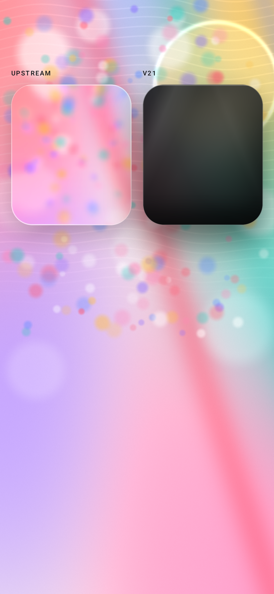
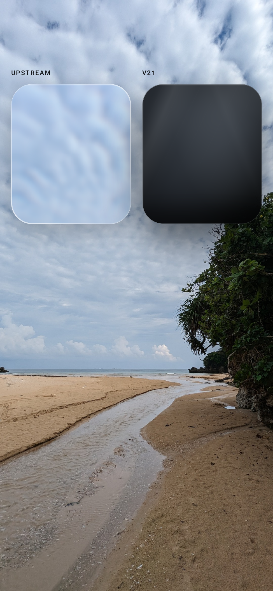
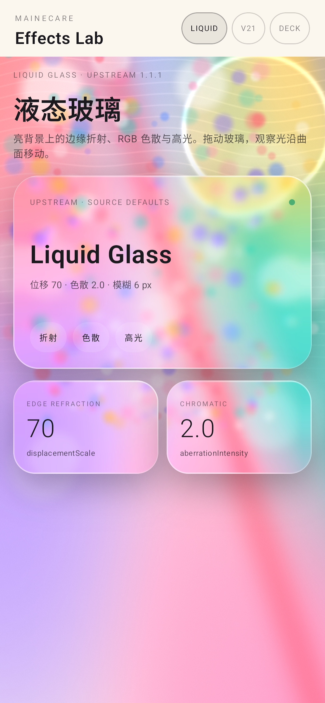
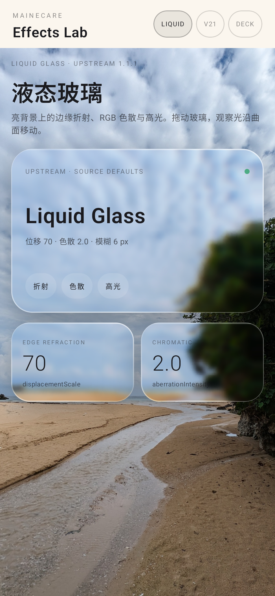

# Liquid glass crystal audit — 0.1.4

Date: 2026-11-06. Branch: `release-0.1.4`. Supersedes the 0.1.3 showcase.

The 0.1.3 showcase was bright, but it still read as “transparency plus blur” rather than
crystal glass. The root cause was not the AGSL path: the bright showcase was rendered with
`overLight=true`, which is **not** the liquid-glass-react default. That flag intentionally

- halves the displacement (`70` → `35`), and
- raises the backdrop blur from `6px` to `14px`.

The result is the milky, uniformly frosted card the user saw. 0.1.4 uses the actual source
default `overLight=false` for the default showcase: full `displacementScale=70`, `6px` blur,
clear glass. The optional overLight treatment is still available with `--es overlight 1`, but
it is not what the demo opens with. No parameter was changed to flatter a screenshot.

## Is AGSL displacement actually running?

Yes. For `GlassEdgeStyle.Upstream` with `overLight=false`:

- `GlassMode.Standard` decodes `liquid_glass_displacement_standard.jpg` and binds it as the
  `uMap` shader; `uProcedural` is 0 (the procedural SDF branch is only for `Shader` mode).
- `uDisplacement = params.signedDisplacementScale * density`; with the source default and
  `overLight=false` this is `-70 × 2.5 = -175` device px at 400 dpi. The R channel shifts x
  and the B channel shifts y (`feDisplacementMap` convention); the G channel is unused.
- `GlassSurface` always creates a `RuntimeShader` and draws it through `drawRect`; there is no
  blur-only fallback. `minSdk=33` is enforced, so AGSL is available on every supported device.
  There is no RenderEffect downgrade path for the glass shader.
- A line probe with displacement on/off differs by card MAE **18.35**; the top/bottom/right
  edge bands differ by **30.6 / 31.2 / 22.5** MAE. The on capture shows bent lines and red/blue
  fringing; the off capture shows straight neutral lines. See
  `evidence/liquid-refraction-line-on-off.png` and
  `evidence/liquid-refraction-line-regions.json`.

The border is also not a plain alpha overlay: `drawUpstreamEdge` draws the 1.5px
screen/overlay gradient, the 0.5px white inset stroke and the top highlight.

## A/B against the real component

Reference: React 19 + installed `liquid-glass-react@1.1.1` in Chromium at device scale 2.5;
Android: the shipped demo at 400 dpi. Same card 342×200 at (24,120), radius 30dp, same
background, `overLight=false`.

| Background | Card MAE | Card SSIM | Inner MAE | Inner SSIM |
| --- | --- | --- | --- | --- |
| Bright showcase | 7.63 | 0.888 | 7.37 | 0.894 |
| CC0 beach photo | 7.32 | 0.900 | 6.93 | 0.907 |

These numbers are **higher** than the 0.1.3 overLight comparison (3.51 / 0.951), because that
comparison matched the milky overLight reference. The 0.1.4 default intentionally targets the
crystal source-default look; the line-probe and the side-by-sides show the effect is present.
We are not using a lower MAE to justify a transparency-only look.






Recordings (drag updates the highlight; the edges bend the background):

- `evidence/liquid-showcase-demo.mp4`
- `evidence/liquid-photo-demo.mp4`

## Platform limits

- AGSL, displacement and aberration are **not** degraded or skipped on API 33+. The platform
  limit is rasterization: Chromium applies `backdrop-filter`, an SVG `feDisplacementMap` and
  DOM edge layers separately; Android samples a pre-blurred bitmap in one AGSL pass. Edge
  compositing cannot be bit-identical.
- The photo and showcase backdrops are static `ImageBitmap` snapshots. A live backdrop under
  scrolling content is still phase 2; this does not affect the refraction path.
- V2528A real-device performance is still pending; emulator numbers remain diagnostic.

## Reproduce

```bash
./gradlew :demo:assembleDebug
adb install -r demo/build/outputs/apk/debug/demo-debug.apk
# crystal showcase (source defaults)
adb shell am start -n com.mainecare.effects.demo.debug/com.mainecare.effects.demo.MainActivity \
  --es screen liquid
# real-photo showcase
adb shell am start -n com.mainecare.effects.demo.debug/com.mainecare.effects.demo.MainActivity \
  --es screen liquid-photo
# upstream vs v21
adb shell am start -n com.mainecare.effects.demo.debug/com.mainecare.effects.demo.MainActivity \
  --es screen ab --es bg photo
```

The beach photo is “Crystal Beach 2” by Syced (Wikimedia Commons, CC0 1.0), resized and
center-cropped to 1080×2400; see `THIRD_PARTY_NOTICES.md`.
