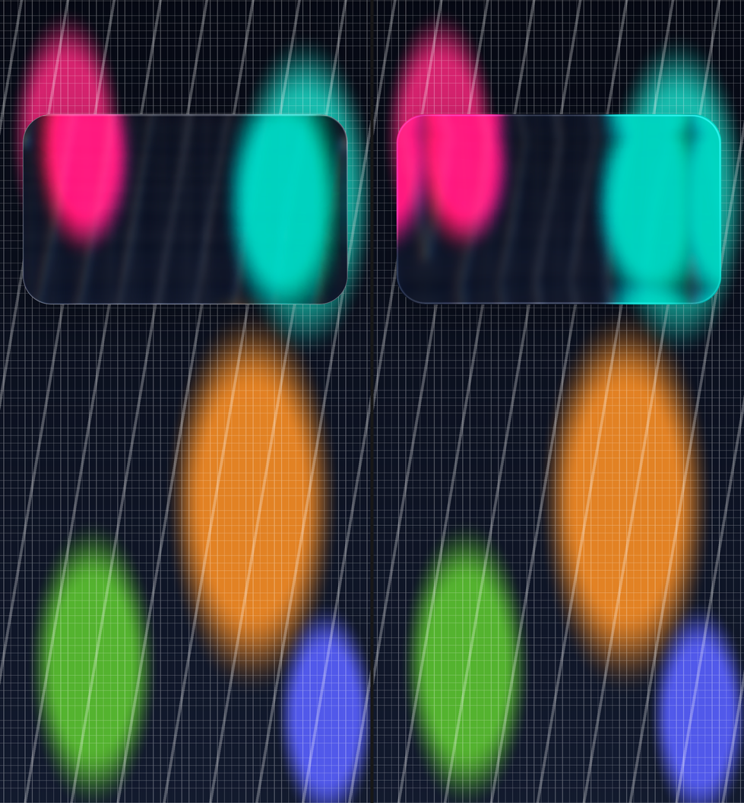
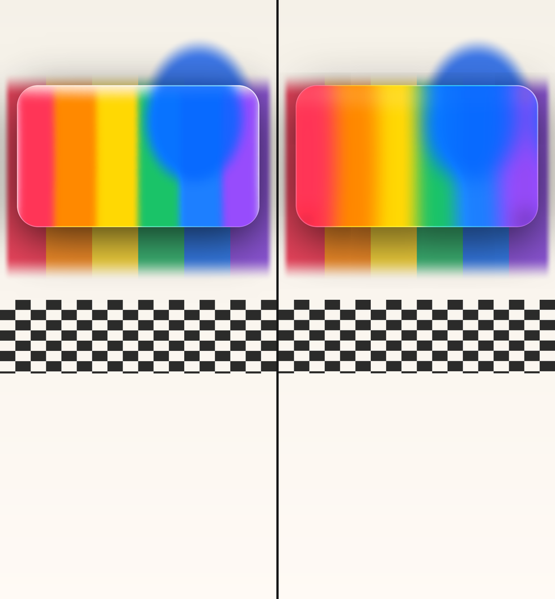
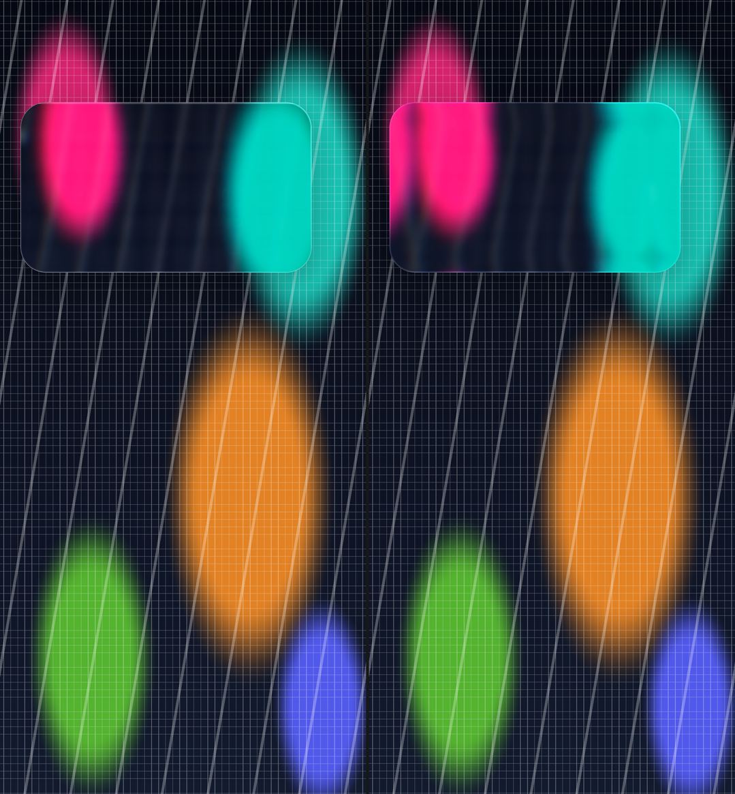
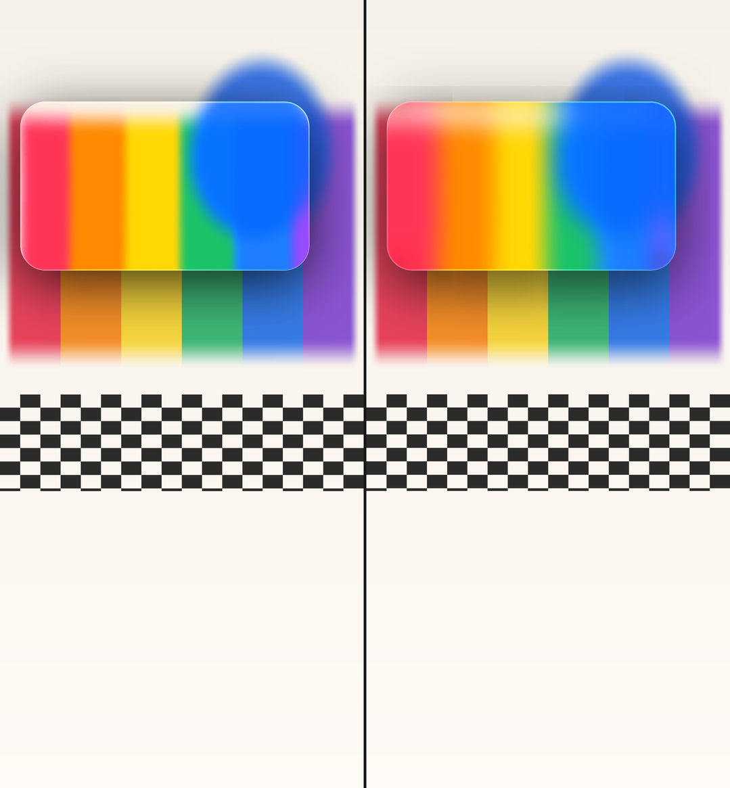
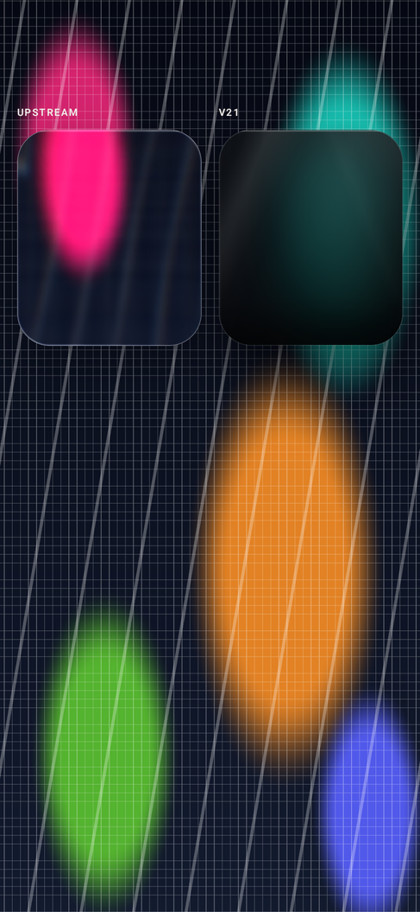
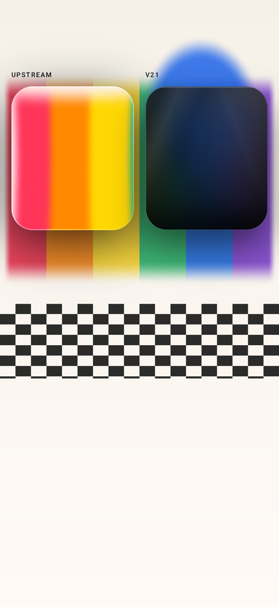

> Historical 0.1.1 comparison. The 0.1.3 audit (`docs/liquid-glass-0.1.3.md`) supersedes it:
> 0.1.1 used 6px blur for the overLight path, while the source formula is 14px.

# Upstream A/B — liquid-glass-react 1.1.1 vs 0.1.1

This is the strict “does it look like the upstream demo” comparison requested after the
real-device feedback. It is not a claim that every edge pixel matches; differences are listed
below.

## Source-of-truth defaults

Verified from `liquid-glass-react@1.1.1` (`node_modules/liquid-glass-react/dist/index.esm.js`
and README), not from memory:

| Prop | Upstream source default | Previous library default | v21 dark preset | `MaineGlassMaterials.Upstream` |
| --- | --- | --- | --- | --- |
| `displacementScale` | **70** | 22 | 22 | **70** |
| `blurAmount` | **0.0625** → 6px backdrop blur | 0.055 → 5.76px | 34px CSS | **6px** |
| `saturation` | **140** | 150 | 150 | **140** |
| `aberrationIntensity` | **2** | 2.2 | 2.2 | **2** |
| `elasticity` | **0.15** | 0.18 | 0.18 | **0.15** |
| `cornerRadius` | **999** | 30 | 30 | **999** (A/B geometry uses 30) |
| `mode` | standard | standard | standard | **standard** |
| `overLight` | false | false | false | **false** |

The README’s example uses `64 / 0.1 / 130 / 2 / 0.35`; that is an example, not the source
default. The v21 presets are deliberately retained and are **not** upstream defaults.

## A/B setup

- Real upstream component: React 19 + `liquid-glass-react@1.1.1` bundled from the installed
  package; not a hand-written approximation.
- Same geometry: card 342×200dp at (24,120), cornerRadius=30dp override (upstream default 999
  is a pill; the override keeps geometry identical); 390×844 and 430×932 viewports.
- Backgrounds: rich dark color/grid, enriched light color bars + checker, plus flat gray and
  line probes.
- Renderer: Chromium at device scale 2.5, fixed 390×844 / 430×932 stage; Android demo at
  975×2110 / 1075×2330 @400dpi, system bars hidden.
- Props: upstream source defaults on both sides; light uses `overLight=true` (the upstream
  light treatment), dark uses false.

Harness: `verification/upstream-demo/` (`main.jsx`, `index.html`, `index-430.html`,
`build-upstream-demo.mjs`, deterministic backgrounds). Set `LIQUID_GLASS_APP` to a React app
with the package installed, run the build script, then capture with Chrome. The bundle and
screenshots are generated, not committed.

## Results

Card region (855×500 device px), same geometry and background:

| Viewport / background | Card MAE | Card SSIM | Inner MAE | Inner SSIM |
| --- | --- | --- | --- | --- |
| 390×844 dark | 16.52 | 0.852 | 14.35 | 0.884 |
| 390×844 light | **9.49** | **0.944** | **8.14** | **0.968** |
| 430×932 dark | 11.63 | 0.957 | 10.64 | 0.964 |
| 430×932 light | 9.24 | 0.959 | 8.10 | 0.973 |

Whole-frame: 390 dark MAE 5.55 / SSIM 0.899; 390 light 2.72 / 0.977; 430 dark 4.01 / 0.925;
430 light 2.26 / 0.991. The light scene is visually close; the dark high-frequency grid
highlights edge differences.






Differences: `evidence/upstream-ab-dark-diff-390.png`,
`evidence/upstream-ab-light-diff-390.png`.

## What was corrected

1. **Defaults were wrong.** The library defaulted to v21-dark values (22 / .055 / 150 / 2.2 /
   .18), so a caller using `LiquidGlassParams()` was not using upstream defaults. They now
   match the source: 70 / .0625 / 140 / 2 / .15 / 999.
2. **Added `MaineGlassMaterials.Upstream`.** Clear glass, 6px blur, saturation 140, upstream
   outer shadow (12/40/.25), upstream edge rim, no tint/sheens/inner shadow. v21 presets are
   unchanged.
3. **Edge rim.** Added `GlassEdgeStyle.Upstream`: 1.5px screen+overlay gradient border, 0.5px
   white inset stroke, top highlight. The v21 border/rim remains for v21 presets.
4. **Opaque backdrop-filter source.** v21’s displacement branch used the blurred element alpha;
   upstream’s backdrop-filter source is opaque. Without this the upstream card darkened at
   edges (flat inner MAE 2.77 → 0.66 after the fix).
5. **Map window.** The centered 1/1.7 element window matches the A/B better than the full map;
   keep that for both presets.
6. **Reference reset.** The upstream reference was missing Tailwind’s
   `box-sizing: border-box`; its 1.5px edge spans were 345×203 and extended outside the card.
   Adding the reset brought the flat card MAE from 4.48 to 0.93.

## Remaining differences and platform limits

- The dark high-frequency grid exposes the upstream **edge refraction/specular** more strongly
  than our Compose/AGSL rendering. Card MAE 16.5 on 390 dark; light is 9.5. This is a raster
  compositing difference, not a parameter claim.
- Upstream applies `backdrop-filter` plus a CSS SVG filter to a DOM element whose filter
  region, edge-span layers and mix-blend modes are rasterized by Chromium. Android samples a
  pre-blurred bitmap in a single AGSL pass; the filter-region/alpha and border-layer
  rasterization cannot be bit-identical. The inner region and line-displacement probe match;
  the residual is at edges/high-frequency color boundaries.
- Flat gray and line probes show the geometry/displacement field matches (line peaks within a
  few pixels). The remaining card error is not solved by changing displacementScale (28/41/70
  all ~14–16 inner MAE) or blurScale alone.
- Do not “fix” this by changing upstream parameters to look nicer. The Upstream preset is the
  source defaults; v21 remains a separate, intentionally stronger/frostier design.

## Demo A/B screen

```bash
adb shell am start -n com.mainecare.effects.demo.debug/com.mainecare.effects.demo.MainActivity \
  --es screen ab --es bg dark
```

`screen=ab` shows upstream (left) and v21 (right); `screen=ab-upstream` / `ab-v21` render one
full card for measurement. `bg=dark|light|color|flat|line` selects the background;
`dispScale` and `blurScale` are diagnostic overrides.



